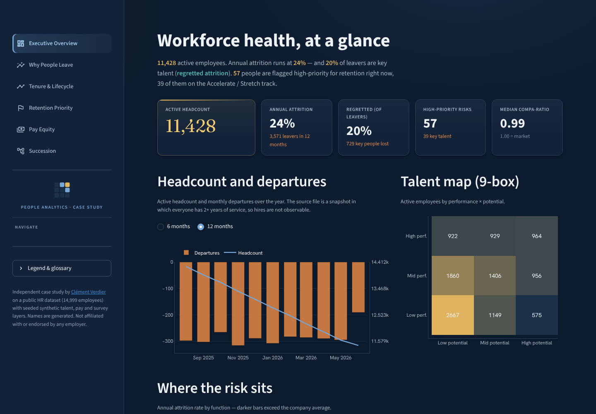
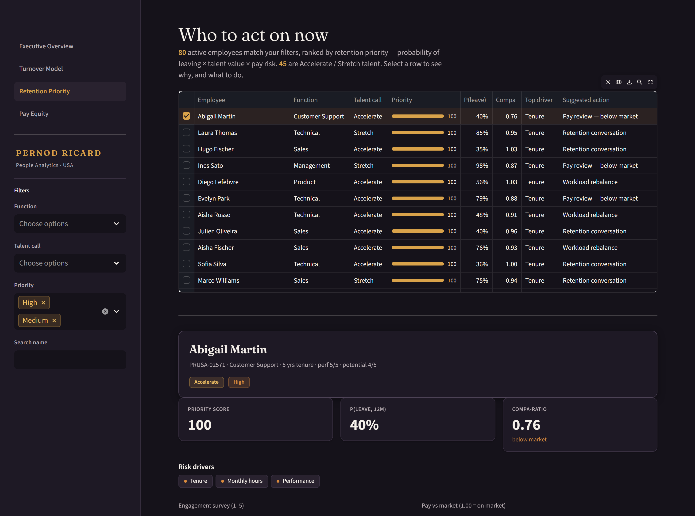
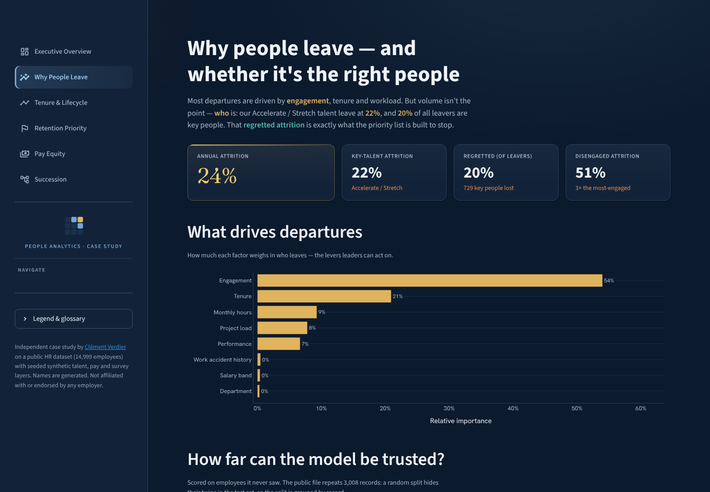
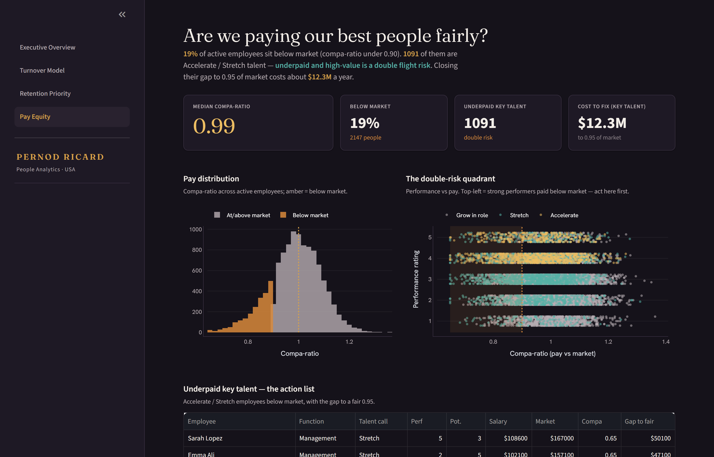
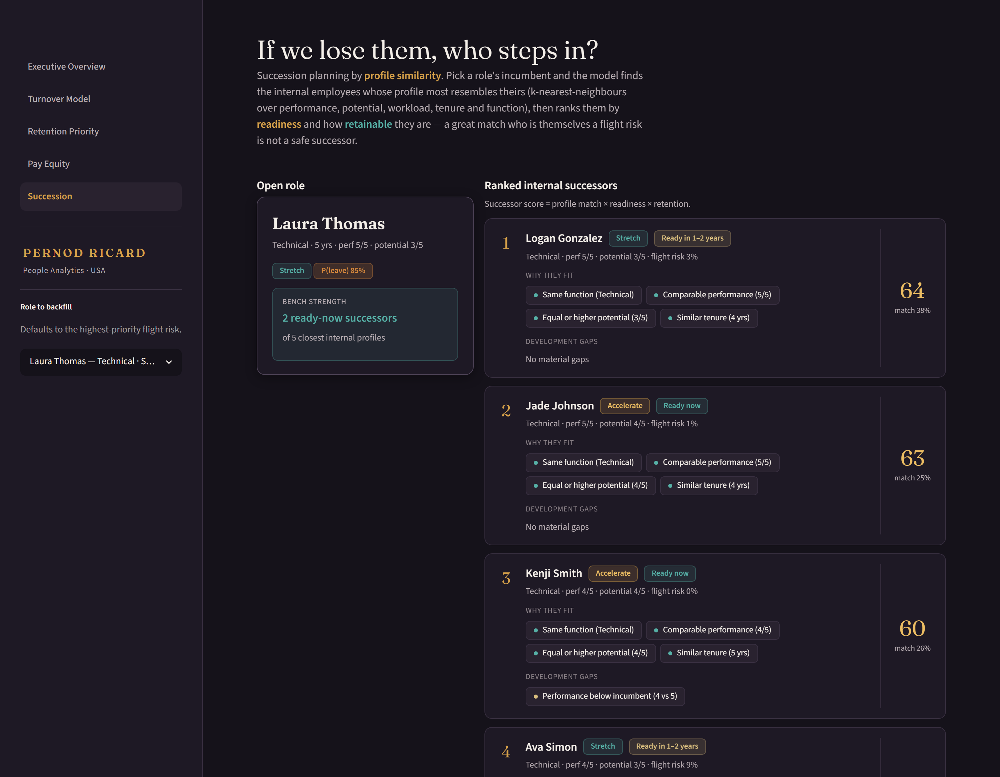

# People Analytics — Retention Priority Dashboard

A decision-first People Analytics dashboard that turns workforce data into **retention
action**, around the way People teams actually work: talent reviews, regretted attrition,
the 9-box, compa-ratio and engagement surveys.

**[Open the live app](https://clement0242.github.io/people-analytics-dashboard/)** — it runs
entirely in your browser (Python via WebAssembly, ~30 s to start the first time; no server,
nothing sent anywhere).

> Independent case study on a public HR dataset with seeded synthetic layers, built while
> preparing an application for a People Analytics role. Names are generated. Not affiliated
> with or endorsed by any employer.

> **The spine — a single Retention Priority Score:**
> `P(attrition)  ×  Talent value (9-box)  ×  Pay risk (low compa-ratio)`
> → a ranked, named list of the people leadership cannot afford to lose, each with the
> *why* (top risk drivers) and a suggested *action*.

The model is not the product. The **decision** is: *who* to act on, *why*, and *what to do* —
with every headline one click from its evidence.



## What it answers

| Page | Leadership question |
|---|---|
| **Executive Overview** | Is the workforce healthy? How much attrition is *regretted*? Where does risk sit? |
| **Turnover Model** | What drives people to leave — and *are the good people the ones leaving*? |
| **Tenure & Lifecycle** | *When* in the journey do we lose people? Where is the mid-tenure cliff? |
| **Retention Priority** | Who do we act on now, and what do we do for each person? |
| **Pay Equity** | Are we paying our best people fairly? Who is underpaid *and* high-value (double risk)? |
| **Succession** | If we lose someone, who steps in? Internal successors by profile similarity. |
| **AI Analyst** | Ask anything in plain language: which department, which people, what to do, how reliable the model is. |



## Approach

**Data.** Backbone is the public `Data/HR.csv` (14,999 employees, real `left` target). On
top of it, `src/build_dataset.py` adds — deterministically and seeded — the talent-review
and reward layers a real People team works with but that the public file lacks: a 27-question
engagement survey (6 dimensions), a 1–5 potential rating, the 9-box and talent call
(Accelerate / Stretch / Grow in role), numeric salary with a market benchmark and compa-ratio,
and lifecycle dates. The dataset's original satisfaction level is kept as the ground-truth
engagement driver, so the augmentation stays anchored to real signal.

**Model, evaluated strictly.** A gradient-boosting classifier (`HistGradientBoostingClassifier`)
predicts attrition. The public file repeats **3,008 records** exactly; a random split hides the
twin of ~29 % of test rows in the training set. So the split is **grouped by record**, the
decision threshold is chosen on **out-of-fold training predictions**, and every employee is
scored by a model that **never saw them**. Result: ROC-AUC **0.983** (0.992 with a naive split),
PR-AUC 0.967 — this dataset is very separable; expect less on real HR data. Global drivers
come from permutation importance. The per-employee "why" asks the model itself: how much
would this person's risk fall if one factor were at the company median?

**The honest check.** Predicting churn isn't enough — healthy churn (low performers leaving)
needs no action. The Turnover Model page verifies that **Accelerate / Stretch talent leave at
meaningful rates**, which is exactly what the priority list exists to stop.

**Succession matching.** When a role opens, the Succession page proposes internal
replacements by **profile similarity** — k-nearest-neighbours over performance, potential,
workload, tenure and function — then re-ranks candidates by readiness (performance × potential)
and retention (1 − flight risk), so a strong match who is themselves a flight risk isn't
offered as a safe successor. Each candidate comes with shared traits ("why they fit") and
development gaps.







## AI Analyst (chat)

A chat page answers questions about the workforce in plain language, with suggested questions and an
optional focus on one employee. It is grounded, not free-wheeling:

- the app computes a **numeric summary** of the data (headline KPIs, model reliability, departments,
  talent calls, tenure, salary bands, engagement, survey dimensions for leavers vs stayers, pay equity,
  suggested actions, the 25 top retention priorities, and the focused employee's full profile) and shows
  it under *What the assistant can see*;
- that summary and the conversation go to a **relay** (Cloudflare Worker) that holds the OpenRouter key —
  never in this repository — and only allows **free models**, with per-IP and daily limits;
- the relay's instructions: answer only from the data, quote the numbers and where they come from, say when
  the data cannot answer, separate correlation from causation, never take individual employment decisions,
  and remind that the data is public + synthetic.

In the browser version, Python runs in a web worker and calls the relay with a synchronous request. When run
with `streamlit run`, setting `OPENROUTER_API_KEY` calls OpenRouter directly with the same free models.

## Run it

```bash
python -m venv .venv && source .venv/Scripts/activate   # Git Bash on Windows
pip install -r requirements.txt

python src/build_dataset.py     # Data/HR.csv -> outputs/people_analytics.csv
python src/model.py             # train + score    -> outputs/scored.csv, metrics.json
streamlit run app/streamlit_app.py
```

## Structure

```
src/build_dataset.py   # augmented dataset (talent, survey, reward layers)
src/features.py        # shared business derivations (9-box, talent call, compa, survey schema)
src/model.py           # training, permutation importance, local drivers, priority score
app/streamlit_app.py   # entry point (page config, theme, navigation, legend)
app/views.py           # the six pages
app/succession.py      # k-NN successor matching
app/theme.py           # design system: tokens, CSS, Plotly template, HTML helpers
index.html             # the same app, run in the browser by stlite (GitHub Pages)
PRODUCT.md / DESIGN.md # strategic + visual design context
```

## Honest limitations

- The survey, potential, compa-ratio and lifecycle dates are **synthetic augmentation** on a
  real attrition backbone — they illustrate the analytical method, not any company's actual
  numbers. All generation is seeded and reproducible.
- The 0.98 AUC reflects how separable this particular dataset is, even after removing the
  duplicate leak; on real HR data, expect lower.
- The file is a snapshot in which everyone has 2+ years of service: departures are spread over
  the last 12 months, and hires are not observable.
- "Headcount evolution" reads flows from a cross-section (departures are spread over 24 months);
  it is descriptive, not a fitted forecast.

## Design

Premium corporate dark theme — **French navy** + **summer blue** (trust, competence), with a
warm **gold** reserved for value (priority, money, the figures leaders read first). The mark
is the 9-box grid itself; no company logo. Serif (Fraunces) for
editorial moments, humanist sans (Hanken Grotesk) for all data. Diverging risk scales are
amber↔teal (colour-blind-safe). Interactive controls on every page (headcount window, tenure
cohort, pay what-if). See `DESIGN.md`.

## Documentation

- [`DATA_AND_MODEL.md`](DATA_AND_MODEL.md) — data sources, full data dictionary, models & scores.
- [`PRESENTATION_SCRIPT.md`](PRESENTATION_SCRIPT.md) — interview walkthrough, page by page.
- [`DESIGN.md`](DESIGN.md) · [`PRODUCT.md`](PRODUCT.md) — design system and product brief.

## Deploy

**GitHub Pages (live version).** `docs/index.html` (served by GitHub Pages from `main` / `docs`) mounts the Streamlit app with
[stlite](https://github.com/whitphx/stlite) (`@stlite/browser` 1.9.2): Pyodide runs the same
Python files in the browser, reading the committed app files and `outputs/` from this repository. `index.html` at the root is the same page with local paths, for testing (`python -m http.server`).
Settings → Pages → *Deploy from a branch* → `main` / `docs`.

**Streamlit Community Cloud (server version).** Create an app at
[share.streamlit.io](https://share.streamlit.io) pointing at `app/streamlit_app.py` on `main`.
